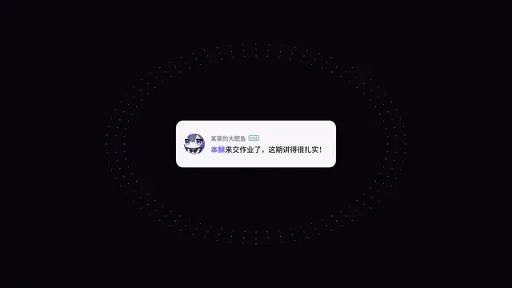

# 02 · 评论形变 Comment Morph



一张内容卡，复制成铺满屏幕的卡片墙，再倾倒、收缩，重组成任意形状（文字、SVG 路径或图片轮廓）。用来表达"很多个 X 汇成了一个 Y"。适合当开头钩子。

[成片 preview.mp4](preview.mp4) · 文件：[`config.js`](config.js)（内容）· [`scene.js`](scene.js)（时间轴）· [`comment-morph.js`](comment-morph.js)（形变系统）

## 套用

```bash
node harness/render.mjs effects/02-comment-morph --config examples/02-custom-shape.js --out out/02
```

[`examples/02-custom-shape.js`](../../examples/02-custom-shape.js) 是一个完整示例：只改标题、形状（心形 SVG 路径）、配色和重点词颜色。

| 字段 | 说明 |
|---|---|
| `card` | 开场主角卡：`name`、`tag`、`text`、`avatar`（图片）或 `initial`（首字母） |
| `titles` | 两行标题；第二行的 `<hl>…</hl>` 会被光标点击 |
| `shape` | 目标形状，三选一：<br>`{ type: 'text', text: 'MOTION', font: '800 300px Inter' }`<br>`{ type: 'path', w, h, d: ['SVG path'], eye?: [x, y], spout?: [x, y] }`（`eye`：脉动亮点，`spout`：上升粒子，坐标都在形状坐标系里）<br>`{ type: 'image', src, w, h, mode: 'alpha' \| 'dark' }`（`alpha` 取不透明处，`dark` 取深色处） |
| `size` / `center` | 形状在屏幕上的宽度（px）和中心 |
| `colors` | 短线颜色 `{ top, bottom }`，按高度渐变；背后的氛围光自动取 `bottom` 压暗 |
| `hl` | 标题重点词的渐变色 `[起, 止]` |

粒子数量由形状面积决定（屏幕上每行间隔 9.5px）。文字形状约 1000–2000 根短线，太细的字体会显得稀疏，建议用 700–900 粗细的字。

## 看点

| 特征 | 做法 |
|---|---|
| 同一个粒子贯穿始终 | 每个粒子从头到尾都是"同一张卡片"：卡片形态（头像 + 两行字）连续变成短线 |
| 由近及远地铺满 | 卡片墙按离中心的距离依次出现；相机从 4 倍拉到 0.42 倍（inOutQuint） |
| 倾倒成透视平面 | 整面墙绕 X 轴转约 64°，透视焦距 1500，远处淡出 |
| 收缩成椭圆 | 外圈先动、内圈后动（错峰），卡片在途中压成 9×3.6px 的短线 |
| 重组成形状 | 形状按"一行行文字"采样短线，长短随机；途中带打旋 |
| 辉光 | 短线阶段把整帧模糊 10px 后再用 lighter 叠加一次，便宜又好看 |
| 活着的细节 | 短线随机闪烁，形状做波浪呼吸；可选的眼睛亮点和喷射粒子 |
| 炸开转场 | 每根短线沿离心方向 inExpo 加速飞出，画成拖影，最后白闪到浅色底，可以直接接 01 无限画布 |

## 动作拆解

| 时间 | 动作 |
|---|---|
| 0–0.6s | 主角卡，背后有一圈点阵光环；镜头开始后拉 |
| 0.35–1.35s | 卡片墙由中心向外铺满屏幕（音效：越来越密的 tickroll） |
| 1.25–1.95s | 卡片墙向后倾倒；第一行标题逐字浮现 |
| 1.85–2.45s | 收缩成扁椭圆，卡片变短线 |
| 2.35–3.45s | 散开、重组成目标形状；第二行标题浮现 |
| 3.35s | 成形，低音轰鸣；之后闪烁、呼吸 |
| 4.25s | 光标点击重点词 |
| 5.6–6.35s | 炸开 + 白闪 |

## 组件

```js
import { CommentMorph, makeMask } from './comment-morph.js';

const mask = await makeMask({ type: 'text', text: 'MOTION', font: '800 300px Inter' });
const morph = CommentMorph(ctx, {
  mask, center: [960, 650], size: 1300, colors: { top: '#F3F1FF', bottom: '#8E7DFF' },
  zoom: t => ...,                                  // 卡片墙阶段的相机缩放
  T: { wall: [.35, 1.35], tilt: [1.25, 1.95], collapse: [1.85, 2.45], form: [2.35, 3.45], burst: [5.6, 6.3] },
});
morph.render(t);
```

## 音效搭配

`tickroll`（铺墙）→ `air`（倾倒）→ `swish`（收缩）→ `sparkle` 加 `shimmer`（成形中）→ `boom`（成形）→ `mouse`（点击）→ `riser` 接 `boom`（炸开）。

## 提示词

```text
做一段 6.5 秒、1920×1080、30fps 的"评论形变"开头：
- 深色底 #06060B，淡点阵。开场是一张白色内容卡（头像、名称、一行字），背后一圈紫色点阵光环。
- 镜头后拉，卡片复制成交错排列的砖墙，由中心向外铺满全屏；约 16% 是灰色卡片。
- 砖墙绕 X 轴向后倾倒成透视平面，再错峰收缩成一个扁椭圆，途中每张卡片连续变形成一根 9×3.6px 的圆角短线。
- 短线散开、重组成 <你的形状：一个词 / 一个图标的 SVG 路径 / 一张透明 PNG 的轮廓>：形状内部按"一行行文字"排布短线（行距约 9.5px，长短随机），颜色从顶部 <浅色> 渐变到底部 <主色>，加整帧模糊叠加的辉光。
- 成形后：短线随机闪烁、整体波浪呼吸。
- 标题两行逐字模糊浮现，第二行重点词用渐变色，光标点击重点词。
- 结尾每根短线沿离心方向加速飞出成拖影，白闪到 #EFEFF3。
- 音效用代码合成并与画面同一时间轴：铺墙用越来越密的嘀嗒，成形用低音轰鸣，炸开用上升音接轰鸣。
```
